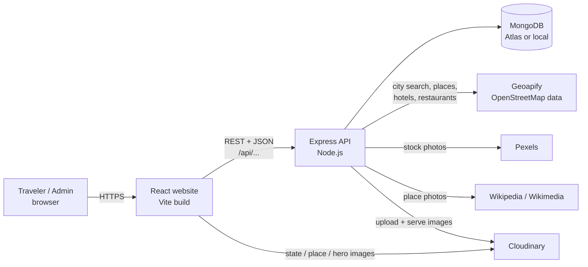
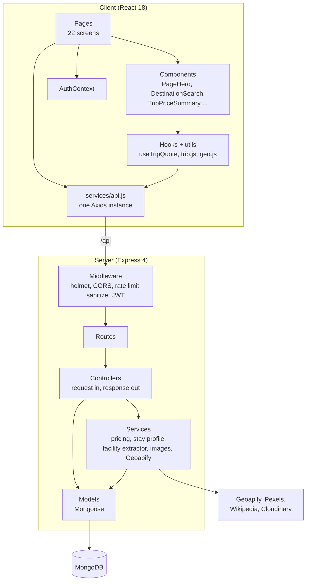
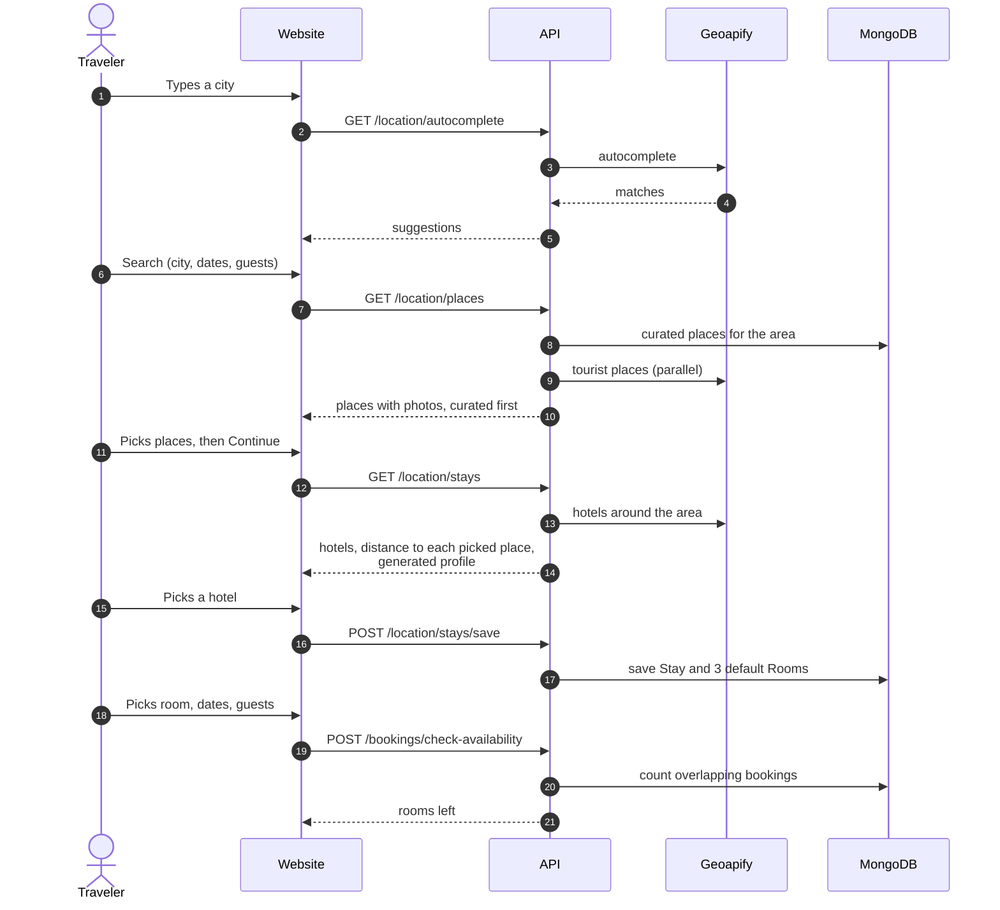
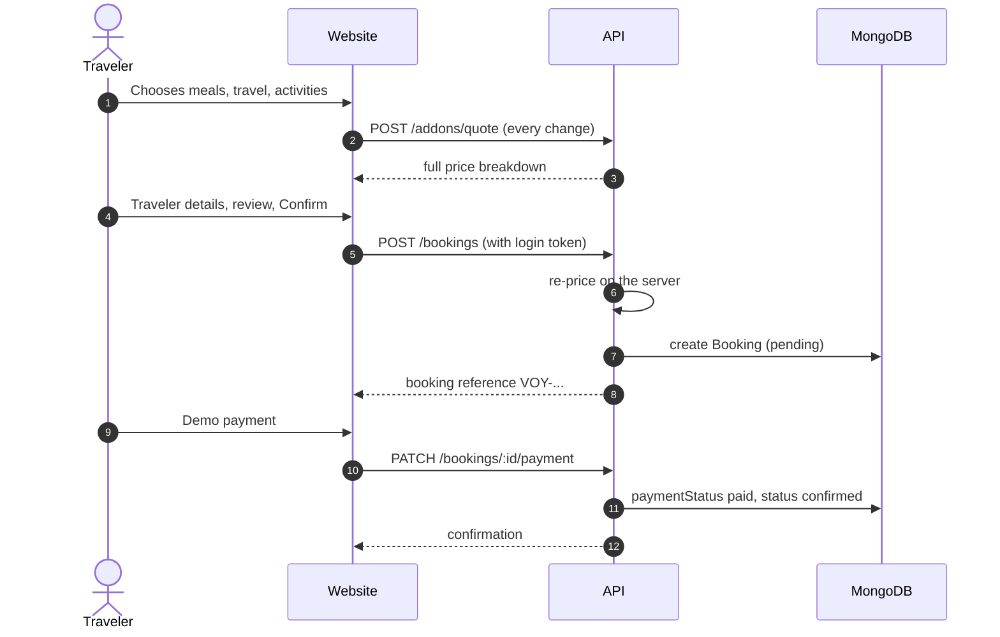
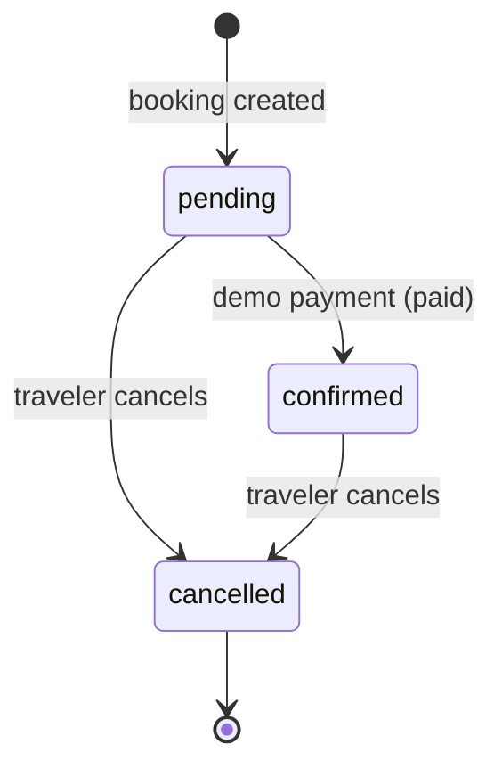
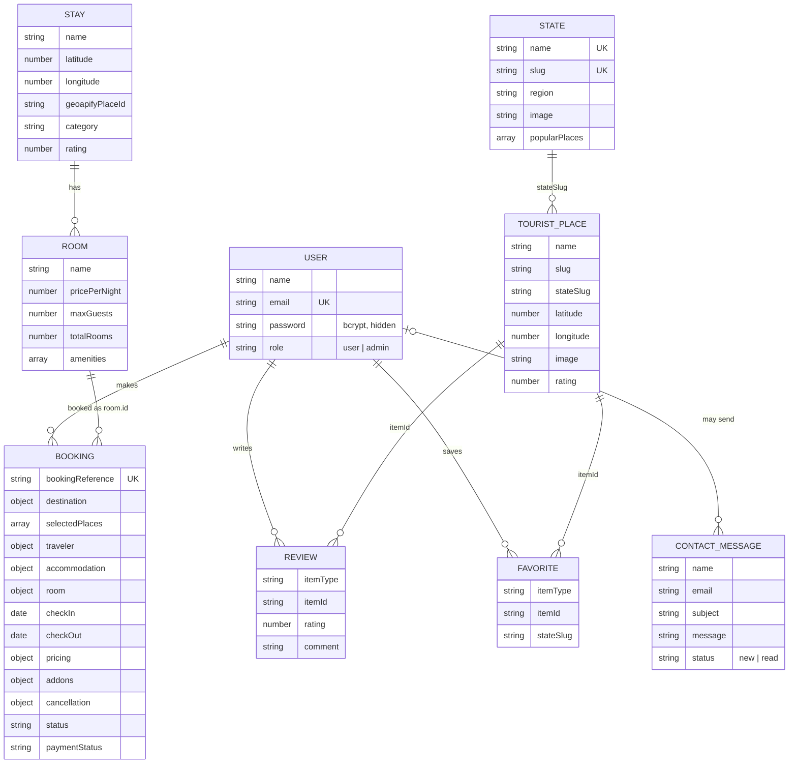
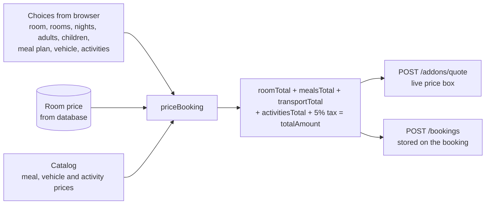
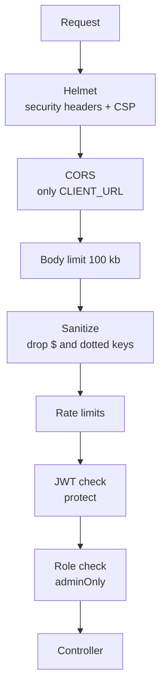
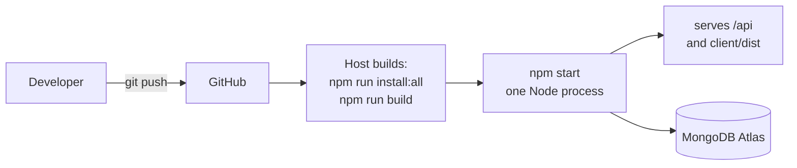

# VOYARA: System Design

How VOYARA is built, why it is built that way, and where it would need to change to grow.
The diagrams use Mermaid, which GitHub and VS Code (with the Markdown Preview Mermaid extension) draw automatically.

---

## 1. Goals and limits

**What the system must do**

1. Let a traveler explore all 36 Indian states and union territories and pick the places they want to visit.
2. Find hotels **near those places**, with real distances.
3. Take the traveler through rooms, dates, meals, local travel and activities to one correct price.
4. Hold a booking, take a (demo) payment, and let the traveler cancel with the right refund.
5. Give an admin a view of bookings, revenue and which services guests choose.

**Design rules**

| Rule | Meaning |
|---|---|
| The server decides the price | The browser sends only choices (room, meals, vehicle, activities). The server looks up the prices and adds them up. A changed number in the browser can never change what is charged. |
| Free outside data is a helper, not a dependency | If the map service is slow or down, curated places, saved hotels and cached results still work. |
| Real data where it exists, generated data where it doesn't | Hotel names, places and restaurants are real. Prices, most star ratings and most amenities are generated, and stay the same for each hotel. |
| Secure by default in production | Strict headers, rate limits, input cleaning, a locked-down upload route, and refusal to start with a weak secret. |

**Known limits (on purpose, for a demo-scale product):** payment is a demo, hotel prices are generated, there is no hotel-owner login, and the last-room booking is not fully protected against two people paying at the same instant (see section 9).

---

## 2. The big picture

In production one Node process serves both the API (`/api/...`) and the built website (`client/dist`), so there is no cross-site setup and no CORS to manage. In development the website runs on Vite (port 5173) and talks to the API on port 5000.

---

## 3. Layers

| Layer | Responsibility | Does NOT do |
|---|---|---|
| Pages | One screen each, owns that screen's state | Price maths |
| Components / hooks | Reusable pieces, the live price box | Talk to the database |
| Routes | Map a URL to a controller, attach middleware | Business logic |
| Controllers | Validate input, call services and models, shape the reply | Long calculations |
| Services | The real logic: pricing, hotel profiles, facility reading, image lookup | Know about HTTP |
| Models | Shape and rules of stored data | Anything else |

---

## 4. The booking journey (the core flow)

**Part 1: from search to a free room**

**Part 2: from extras to a confirmed booking**

The trip is carried from page to page in the browser's router state (`utils/trip.js`), so nothing is stored on the server until the booking is created.

### Booking states

| Status | Payment status | Rooms held? |
|---|---|---|
| pending | pending | Yes |
| confirmed | paid | Yes |
| cancelled | refunded (when a refund applies) or unchanged | No, the rooms are free again |

**Cancellation rule:** full refund when the hotel offers free cancellation **and** check-in is more than 24 hours away. Otherwise the booking is cancelled with no refund. The traveler sees the exact amount before confirming.

---

## 5. Data design

**Why a booking copies data instead of pointing at it.** A booking stores the hotel name, room name, price per night, traveler and every priced extra *as they were at booking time*. Later changes to a hotel or a price never rewrite a past booking, and My Trips and the admin page need no extra lookups.

**Indexes**

| Collection | Index | Why |
|---|---|---|
| users | `email` unique | login, no duplicate accounts |
| bookings | `bookingReference` unique, `user` | confirmation lookup, My Trips |
| reviews | `user + itemType + itemId` unique | one review per person per place |
| favorites | `user + itemType + itemId` unique | saving twice is harmless |
| tourist places | `stateSlug + slug`, text on name/description/city | place pages, search |
| states | `name`, `slug` unique, text index | state lookup, search |
| stays, rooms | location and `stay` | find a hotel's rooms |

### Availability

For a room and a date range, the server adds up the rooms of every pending or confirmed booking that overlaps the range (`existing.checkIn < new.checkOut` and `existing.checkOut > new.checkIn`) and subtracts that from the room's `totalRooms`. Cancelling a booking removes it from that count, so the rooms come back automatically. No counter is stored, so it cannot drift out of sync.

---

## 6. Pricing engine

Pricing lives in one place, `server/services/addonCatalog.js`, and is used by both the live quote and the booking.

| Part | How it is worked out |
|---|---|
| Room | `pricePerNight x rooms x nights` |
| Meals | Base per person per night (breakfast 250, lunch 400, dinner 450) times a factor that grows with the room price (0.7 to 2.5). Children under 12 pay half. Plans: Room only, Breakfast, Half board, Full board, or any single meals. |
| Local travel | Cab, SUV, bus or bike, AC or non-AC, per day, times days. Bike is non-AC only. |
| Activities | Six fixed experiences, plus nearby attractions priced by a stable formula from their id. Per person. |
| Tax | 5% of room plus add-ons |

Because the same function prices the quote and the booking, the price on the screen and the price charged cannot disagree.

### Generated hotel profile

`stayProfile.js` turns a hotel's id into a stable price, star class, rating, amenity list and free-cancellation flag. The same hotel always gets the same result. Names that sound luxury (palace, resort, grand) are priced higher. When the map data **does** list a fact (stars, Wi-Fi, parking, pool, phone, website), that real fact wins and the app marks it "listed". `facilityExtractor.js` reads those facts from the raw map tags.

---

## 7. Security design

| Threat | Defence |
|---|---|
| Stolen or guessed passwords | bcrypt (cost 12), 8+ characters with a letter and a number, login limited to 20 wrong tries per 15 minutes per address |
| Forged login tokens | Signed with `JWT_SECRET`. Production refuses to start if the secret is under 32 characters or on a list of weak ones |
| NoSQL injection | Request bodies and queries are cleaned: keys starting with `$` or containing `.` are dropped. Types are checked in controllers |
| Price tampering | The browser never sends a price. The server re-prices every booking |
| Reading someone else's trip | Every booking lookup filters by the logged-in user's id |
| Admin pages | Checked on the server (`adminOnly`), not just hidden in the menu |
| Open upload route | Upload routes need login **and** admin |
| Contact form spam and injection | A hidden trap field, a limit of 5 messages per 15 minutes, plain-text validation (objects and arrays rejected), length limits, and messages shown as text. Only admins can list them |
| Scraping and floods | Limits on the API (1500 / 15 min), search (90 / min), booking (60 / 15 min), contact (5 / 15 min). Active in production, or in development with `RATE_LIMIT=on` |
| Clickjacking, sniffing, XSS | Helmet headers and a content security policy |
| Leaking details on errors | In production a server error returns a generic message, the health check hides database details |
| Secrets in code | All keys are in `server/.env`, which is never committed |

Only a real "not logged in" answer (401 or 403) signs a user out on the website. A busy server or a short network drop does not.

---

## 8. Performance and reliability

| Technique | Where | Effect |
|---|---|---|
| Parallel category queries | Places search | One slow category does not hold up the rest |
| 1 hour in-memory cache | Places results | Repeat searches return instantly. Thin results are not cached |
| Theme applied before first paint | `index.html` | No white flash in dark mode, no layout change |
| Motion only on opacity and transform | Client | Smooth on phones, no layout jumps. Skipped for reduced motion |
| Photo time budget and backoff | Place and hotel images | A rate-limited photo service (429) cannot freeze the page |
| Curated places first | Places | Always something useful to show, even if the map service is slow |
| Lazy-loaded pages and split bundles | Client | Each page loads only its own code |
| gzip compression | Server | Smaller responses |
| Photos from Cloudinary with `f_auto,q_auto` | Client | Right format and size per device |
| Graceful shutdown | Server | On stop, finishes current requests and closes the database |
| Health check | `GET /api/health` | Returns 503 when the database is down, so a host can restart or alert |
| Startup checks | `config/env.js` | Missing or weak settings stop the server with a clear message |

---

## 9. Trade-offs and what to change at larger scale

| Today | Why | If traffic grows |
|---|---|---|
| One Node process | Simple, cheap, enough for a demo | Run several copies behind a load balancer. Move the rate limiter and the places cache to Redis so the copies share them |
| In-memory places cache | No extra service | Redis |
| Availability counted on read, then re-checked after saving (earlier bookings by `_id`) | No drift, simple, closes the common race | Wrap "check, then create" in a MongoDB transaction, or use an atomic counter per room per night, so two people cannot take the last room at the same instant |
| Demo payment, or Razorpay when keys are set | No money, no risk by default | Razorpay order, signed callback and signed webhook are built in. Test with TEST keys, then go live. The demo endpoint answers 403 once keys are set |
| Generated hotel prices | No free hotel price API exists | Connect a channel manager or hotel partner API, or add a hotel-owner portal to set real prices and photos |
| Images fetched on demand, then saved | Free tiers | A background job that pre-fills images, plus a CDN |
| Emails sent in-process, optional | Simple, off without SMTP | Send from a queue with retries |
| Admin can search, export CSV, cancel, refund and set roles | Runs bookings from the dashboard | Add edit screens for places and hotels |

---

## 10. Deployment

Hosting on one platform (Render, Railway, a VPS):

1. Create a MongoDB Atlas cluster and put its address in `MONGO_URI`.
2. Set `NODE_ENV=production`, a 48-byte `JWT_SECRET`, and the Geoapify, Cloudinary and Pexels keys.
3. Build command: `npm run install:all && npm run build`. Start command: `npm start`.
4. First start loads the 36 states and 234 places by itself.
5. Make yourself admin: `npm run make-admin -- you@example.com`.

If the website is hosted separately (Vercel, Netlify), set `CLIENT_URL` on the server to the website's address and `VITE_API_URL` on the website to the server's address ending in `/api`.
